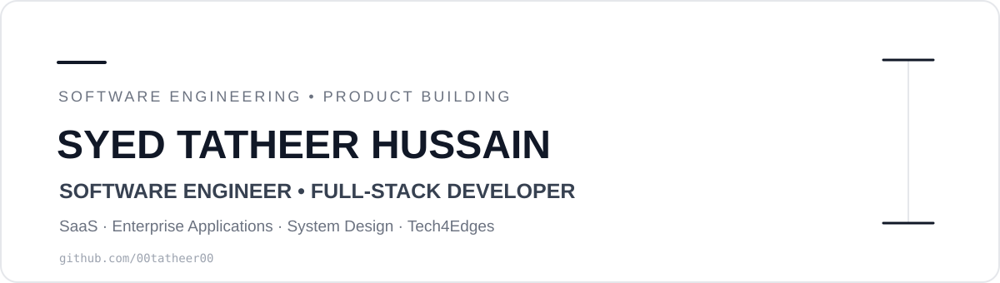

<!-- Profile README for 00tatheer00 -->

---

## About

I'm **Syed Tatheer Hussain**, a software developer focused on building practical web applications, full-stack platforms, SaaS products, and business management systems.

I work across the product lifecycle — from understanding a problem and designing its architecture to implementation, testing, and deployment. I am the **Founder of Tech4Edges** and also contribute to technology education and developer mentoring.

- **Primary focus:** Full-Stack Development, SaaS, and Business Software
- **Frontend:** React, Next.js, TypeScript, JavaScript, Tailwind CSS
- **Backend:** Node.js, Express.js, PHP, Laravel, REST APIs
- **Databases:** MongoDB, PostgreSQL, MySQL, Supabase, Firebase
- **Engineering interests:** System Design, Authentication, RBAC, CI/CD, Cloud Deployment, AI-assisted workflows
- **Based in:** Pakistan

---

## Technology Stack

---

## Selected Projects

A selection of projects that demonstrate different areas of my software engineering work. See the repositories for implementation details and setup instructions.

| Project | What it demonstrates | Stack |
|---|---|---|
| [ShopFlow](https://github.com/00tatheer00/ShopFlow---Mobile-Shop-Management-SaaS) | Mobile-shop SaaS: POS, IMEI inventory, customer ledgers, expenses, and multi-tenant data isolation | Next.js, TypeScript, Supabase |
| [Wholesale Distributor System](https://github.com/00tatheer00/WholeSale-Distributor-System) | Pharmaceutical distribution ERP with batch/expiry workflows, stock ledgers, sales, finance, and reporting | Next.js, TypeScript, PostgreSQL, Prisma |
| [Student ERP System](https://github.com/00tatheer00/Student-ERP-System) | University operations: students, attendance, courses, results, fees, roles, and analytics | MongoDB, Express, React, Node.js |
| [Visitor & Student Management](https://github.com/00tatheer00/Institute-of-Health-Sciences-Visitor-Student-Management-System) | Visitor check-in/out, student QR scanning, logs, and administration | React, Node.js, Express, MongoDB |
| [AVENZON Marketplace](https://github.com/00tatheer00/AVENZON-Enterprise-Multi-Vendor-Marketplace) | Multi-vendor marketplace project | See repository |
| [Personal Portfolio](https://github.com/00tatheer00/tatheer.dev) | Personal portfolio website and SEO foundations | HTML, CSS, JavaScript |

---

## Engineering Approach

- Build around real user and business workflows.
- Prefer clear architecture, maintainable code, and typed interfaces.
- Treat authentication, authorization, validation, and data integrity as core requirements.
- Document setup steps and operational decisions.
- Verify changes with builds, tests, and deployment checks where available.

---

## GitHub Activity

  

---

## Current Focus

`Full-Stack SaaS` · `Enterprise Applications` · `System Design` · `Cloud & CI/CD` · `AI-assisted Development`

---

**Building useful software, one problem at a time.**

